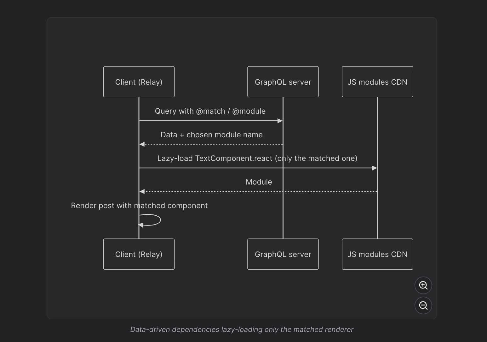

# Understanding Facebook's Relay and Data-Driven Dependencies

The main idea is that Relay connects React components, GraphQL data requirements, and client-side caching. Its data-driven dependencies feature goes a step further: the type of data returned by the server can determine which JavaScript component needs to be downloaded.

There are actually two distinct concepts here:

1. Data colocation: Every React component declares which GraphQL fields it needs.
2. Data-driven dependencies (3D): The server's returned data type determines which component module should be loaded.

Let's understand them using the Instagram/Facebook-style news feed we've been designing.

## 1. First, why does Facebook use Relay?

Imagine your `PostCard` has three child components:

NewsFeed

PostCard

PostAuthor

name, avatar

PostContent

text, media

Engagement

reactions, counts

In a conventional REST + React Query implementation, the parent might fetch a complete Post object and pass pieces of it to the children.

```
function PostCard({ post }) {
  return (
    <>
      <PostAuthor user={post.author} />
      <PostContent body={post.body} />
      <Engagement summary={post.engagementSummary} />
    </>
  );
}
```

The problem is that when `PostAuthor` needs a new field like `isVerified`, someone might need to update the API contract or fetching logic higher in the component tree.

Relay addresses this by allowing each component to declare its own data requirements through GraphQL fragments.

## 2. How React components declare their data needs

Consider this React component:

```
import { graphql, useFragment } from "react-relay";

const authorFragment = graphql`
  fragment PostAuthor_user on User {
    name
    profilePhotoUrl
    isVerified
  }
`;

function PostAuthor({ user }) {
  const data = useFragment(authorFragment, user);

  return (
    <div>
      
      <span>{data.name}</span>
      {data.isVerified && <VerifiedBadge />}
    </div>
  );
}
```

Notice something important:

The `PostAuthor` component itself declares exactly which fields it requires.

It doesn't directly call Axios, and it doesn't need the parent to manually assemble an author object.

The parent composes that fragment into its own data requirement:

```
fragment PostCard_post on Post {
  id
  author {
    ...PostAuthor_user
  }
  content {
    ...PostContent_content
  }
}
```

The top-level feed query includes `PostCard_post`:

```
query NewsFeedQuery {
  feed {
    posts {
      ...PostCard_post
    }
  }
}
```

Relay's compiler combines the fragments into the data requirements of the feed operation. The query fetches the fields required by the descendant components, and Relay stores the returned records in its client-side normalized store.&#x20;

[image](https://www.google.com/s2/favicons?domain=https://relay.dev&sz=32)

Relay+1

So although every component declares its own requirements, that doesn't mean every component makes a separate network request.

This is called data colocation.

How Relay coordinates the data

Component GraphQL Fragments

Author fields + Content fields + Engagement fields

Relay Compiler

Composes fragments into operation artifacts

GraphQL API

Returns the requested data

Relay Normalized Store

Components read their own fragments

This connects directly to our earlier `postsById` and `usersById` discussion. Relay provides an integrated normalized-store system, rather than requiring you to implement all normalization manually.

## 3. Now, what are data-driven dependencies?

This is the more interesting part of your question.

Imagine that a Facebook news feed supports different post types:

Text Post

TextPostRenderer

[This country was just named the most relaxing destination on Earth](https://images.openai.com/static-rsc-4/fQRJkboNIwEQsTBVbvk1Ub2Kf3hGnYP6vIEROhVSNhuF7ZA0_f1p1dIetZ4nFPWKnUppwXZb_fHAdhYpsmiyrsHwXLL24r4cUM4boqnO4W_uKI3odgpJ4iaauFCzOylRPhZ7602-ZZS5oCmTfSeHG8ez1to7FFglpSon4153LXU?purpose=inline)

Image Post

ImagePostRenderer

Video Post

VideoPostRenderer

Each type needs different data and a different React renderer.

For example:

```
type PostContent =
  | { type: "TEXT"; text: string }
  | { type: "IMAGE"; imageUrl: string; width: number }
  | { type: "VIDEO"; videoUrl: string; duration: number };
```

### Without data-driven dependencies

One straightforward approach is to import every renderer upfront:

```
import TextPost from "./TextPost";
import ImagePost from "./ImagePost";
import VideoPost from "./VideoPost";

function PostContent({ content }) {
  switch (content.type) {
    case "TEXT":
      return <TextPost content={content} />;

    case "IMAGE":
      return <ImagePost content={content} />;

    case "VIDEO":
      return <VideoPost content={content} />;
  }
}
```

Even if the current feed contains only text posts, the JavaScript for all three renderers may be included in the initial bundle, depending on the bundler and chunking configuration.

That can increase JavaScript download, parsing and execution costs.

You can improve this with `React.lazy()` and dynamic imports:

```
const TextPost = React.lazy(() => import("./TextPost"));
const ImagePost = React.lazy(() => import("./ImagePost"));
const VideoPost = React.lazy(() => import("./VideoPost"));
```

But Relay's data-driven dependencies integrate the renderer selection more closely with the GraphQL response.

## 4. Understanding `@match` and `@module`

Here is your GraphQL example:

```
... on Post {
  content @match {
    ...TextPostFragment
      @module(name: "TextComponent.react")

    ...ImagePostFragment
      @module(name: "ImageComponent.react")
  }
}
```

Assume `content` is a GraphQL union that can resolve to either a `TextContent` or an `ImageContent`.

The corresponding fragments would conceptually be defined on those concrete types:

```
fragment TextPostFragment on TextContent {
  text
}

fragment ImagePostFragment on ImageContent {
  imageUrl
  alt
}
```

Now look at the two directives.

### `@match`

This indicates that the content may resolve to one of several supported types, each associated with a rendering module.

### `@module(name: "...")`

This associates a fragment/type branch with the JavaScript module that knows how to render it.

For example:

- `TextContent` → `TextComponent.react`
- `ImageContent` → `ImageComponent.react`

Together, they form Relay's data-driven dependencies, also called 3D. Relay's documentation describes this as loading only the component code needed for the data actually returned.&#x20;

[image](https://www.google.com/s2/favicons?domain=https://relay.dev&sz=32)

Relay+1

## 5. What actually happens when the API responds?

Suppose your feed contains a text post and an image post.

GraphQL query requests Post content

GraphQL server resolves the concrete content type

TextContent or ImageContent

TextContent

Text data + module metadata

Load TextComponent

ImageContent

Image data + module metadata

Load ImageComponent

React renders the appropriate post components

A simplified conceptual server response might look like:

```
{
  "content": {
    "__typename": "ImageContent",
    "imageUrl": "/media/photo.jpg",
    "alt": "Mountain landscape",
    "module": "ImageComponent.react"
  }
}
```

This is illustrative, not the literal Relay wire format. Relay uses compiler-generated metadata and runtime-specific module references.

The important steps are:

1. The server resolves the actual GraphQL content type.
2. The matching type's fields and module metadata are returned.
3. Relay processes the response using its compiled artifacts.
4. The client loads the matching renderer if its JavaScript module is not already available.
5. React renders that component using the associated data.

If only text posts appear in a feed, the image-specific rendering module may not need to be downloaded.

Important nuance: The server does not execute React or send arbitrary JavaScript code. The component modules are known to the build system in advance; the returned metadata helps select the appropriate compiled module.

## 6. How is this different from React.lazy?

| React.lazy                                                    | Relay data-driven dependencies                                         |
| ------------------------------------------------------------- | ---------------------------------------------------------------------- |
| Splits React component code into dynamically loadable modules | Coordinates data selection and component-module loading                |
| Component selection is typically written in client-side logic | GraphQL type branches and module associations are declared together    |
| Data fetching is handled separately                           | Data requirements are colocated in Relay fragments                     |
| Can load code when React attempts to render it                | Can arrange module loading using information from the GraphQL response |
| Works without GraphQL                                         | Requires Relay/compiler integration                                    |

The biggest benefit is not merely code splitting. React already supports that.

It's coordinating the data dependency and the JavaScript dependency, so the client can obtain the correct renderer without a separate discovery request once the returned content type is known.

For large applications with many specialized post types, this helps avoid shipping a large bundle containing renderers that a particular user may never see.

## 7. How does this connect to your Parspec experience?

Think about your RFQ document workflow.

Suppose an RFQ can contain several specialized document types:

- Standard PDF document
- Manufacturer-specific specification sheet
- Interactive product configuration
- Technical drawing preview

Without data-driven dependencies, you might bundle every specialized viewer with the initial RFQ page, even though a particular RFQ only contains PDFs.

A data-driven approach would let each document type declare its necessary data and dynamically load its appropriate renderer.

For example, a PDF viewer might need `documentUrl` and `pageCount`, whereas a product configurator might require `configurationSchema` and `availableOptions`.

You don't need Relay to implement this design; React.lazy with dynamic imports and an appropriately structured API can achieve much of the benefit.

Relay becomes particularly valuable when component-specific GraphQL fragments, normalized caching, and dynamic renderer selection need to work together at large scale.

## 8. One implementation caveat

Your snippet is a conceptual example of Relay's `@match` and `@module` capabilities, not necessarily a drop-in example for every Relay project.

The current Relay compiler has explicit configuration for module imports and for where `@module` is enabled. The exact integration depends on the compiler/runtime configuration and module loader.&#x20;

[image](https://www.google.com/s2/favicons?domain=https://relay.dev&sz=32)

Relay

For learning Relay today, I would start with fragments and `useFragment`, then normalized caching, pagination connections, and finally `@match`/`@module`.

## Final summary — Frontend system design notes

- Relay: A GraphQL client for React that manages data fetching, normalized caching, and subscriptions to cached data.
- Data colocation: React components declare their own required fields using GraphQL fragments.
- `useFragment`: Reads a component's declared fields from Relay's normalized store.
- Fragment composition: Relay combines component-level fragments into parent queries, avoiding the need for every child to fetch independently.
- Data-driven dependencies (3D): The data returned by the server helps determine which JavaScript renderer module needs to be loaded.
- `@match`: Marks a field where different concrete data types can require different rendering implementations.
- `@module`: Associates a matching GraphQL fragment/type with a specific JavaScript module.
- Code splitting: Only renderer modules needed for the returned content have to be loaded.
- Performance benefit: Avoids eagerly downloading every specialized renderer and helps coordinate data and code loading.
- Compared with React.lazy: Relay extends ordinary code splitting by associating GraphQL data branches with renderer modules.
- Large-scale feed design: Particularly useful when a news feed supports many different post types and rendering strategies.

Interview-ready explanation:

> "Relay allows React components to colocate their GraphQL data requirements through fragments. The Relay compiler composes those fragments into queries, and components read their data from a normalized store. Data-driven dependencies extend this model using `@match` and `@module`, allowing the content type returned by the GraphQL API to determine which React renderer module gets downloaded. This improves JavaScript loading efficiency in applications with many heterogeneous content types, such as Facebook's news feed."

Recommended references: [Relay Fragments Tutorial](https://relay.dev/docs/tutorial/fragments-1/?utm_source=chatgpt.com) and [Relay Glossary — 3D, @match and @module](https://relay.dev/docs/glossary/?utm_source=chatgpt.com).


