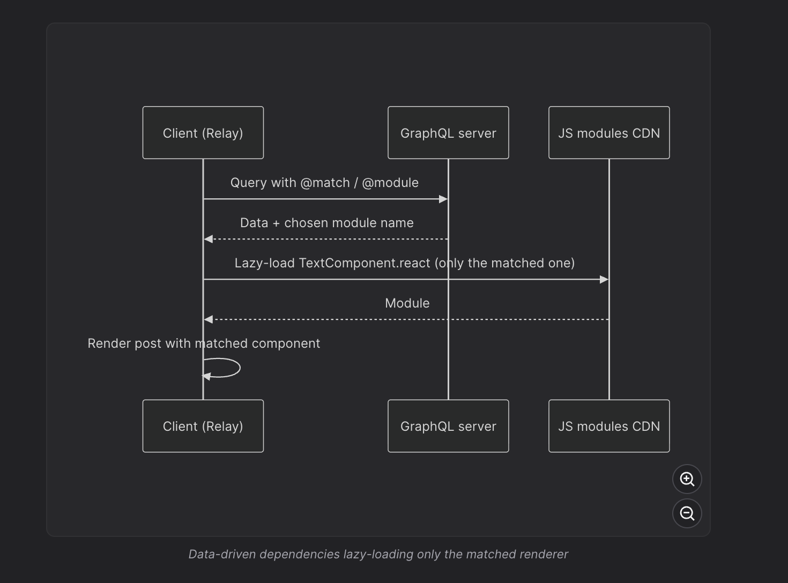
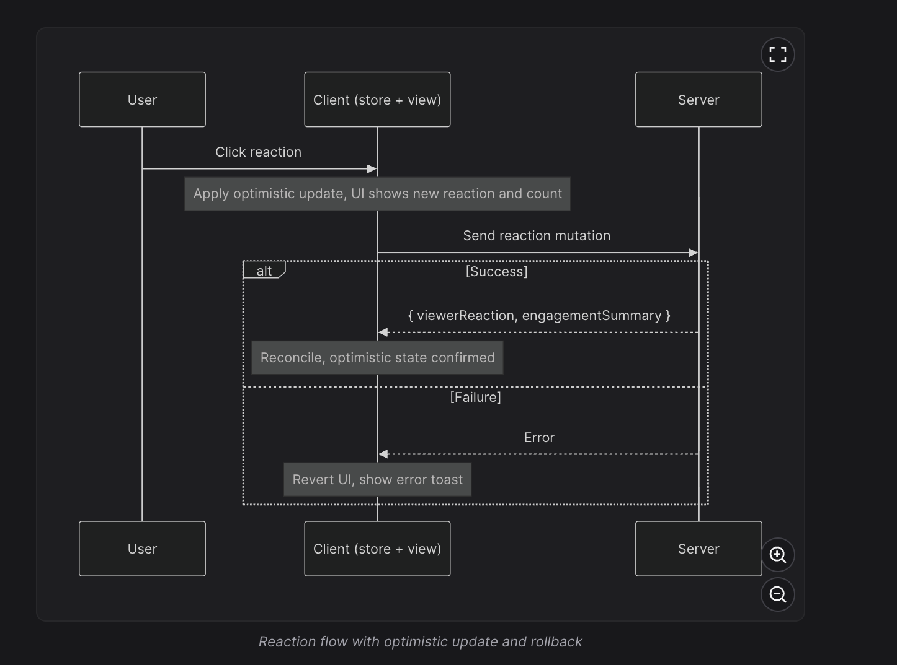

# Feed Post Optimisations

## Delivering data-driven dependencies only when needed

- Multiple post formats: Facebook supports 50+ post formats (text, images, videos, polls, etc.), each requiring specialized React rendering components.
- Problem with eager loading:
  - Loading all renderer modules upfront increases JavaScript bundle size.
  - Unused JavaScript increases download, parsing, and execution costs, negatively affecting initial page performance.
- Traditional lazy loading (`React.lazy`):
  - Dynamically imports components based on the post type.
  - Can introduce a data-then-code waterfall if the renderer is discovered only after the API response arrives.
- Relay + GraphQL:
  - Relay allows React components to declare their data requirements using GraphQL fragments.
  - Combines component-level data requirements into queries and maintains a normalized client-side cache.
- Data-driven dependencies (3D):
  - Relay uses `@match` and `@module` directives to associate GraphQL content types with corresponding React renderer modules.
  - `@match`: Enables type-dependent selections on a GraphQL field.
  - `@module`: Associates a GraphQL fragment with its corresponding JavaScript renderer.
  - The GraphQL response includes metadata identifying the matching renderer, which Relay can load dynamically.
- Execution flow:
  ```
  GraphQL request
       ↓
  Server resolves post type
       ↓
  Returns data + renderer metadata
       ↓
  Relay loads matching JS module
       ↓
  React renders the post
  ```
- Performance benefits:
  - Avoids shipping unused renderer modules.
  - Reduces initial bundle size and JavaScript processing costs.
  - Coordinates GraphQL data requirements with component code loading.
  - Enables more targeted prefetching of required modules.
- Data-then-code waterfall:
  - Dynamic imports may introduce additional latency if JavaScript downloading begins only after data fetching finishes.
  - Mitigation: Eagerly load common above-the-fold renderers through Tier 2 loading or prefetch likely required chunks after the initial feed payload reveals their types.
- Beyond feed posts: Lazy load interaction-heavy components such as hover cards, rich-text composers, media editors, and advanced widgets only when needed or when user intent becomes likely.

Interview takeaway: Data-driven dependencies combine Relay's GraphQL fragments with dynamic component loading to minimize unused JavaScript. The key performance trade-off is balancing smaller initial bundles against potential data-then-code waterfalls, mitigated through intelligent prefetching and tiered loading.



## Rendering mentions/hashtags

\- Entity Ranges (Recommended):

- Store plaintext once, with metadata identifying mentions, hashtags, and links.
- Each entity contains `type`, `start`, `end`, and optional metadata such as `userId` or `url`.
- `start` is inclusive, `end` is exclusive, matching JavaScript's `String.slice(start, end)`.
- Compact, platform-independent, and suitable for API communication.
- Trade-off: Editing text requires recalculating entity offsets when characters are inserted or deleted.
- Define a consistent offset convention, such as UTF-16 indices over NFC-normalized text.

\- Custom Syntax:

- Encodes entities inline, e.g., `[[#1234: HBO Max]]`.
- Stores both entity identity and display text.
- Hashtags can often be identified using regex.
- Simple and lightweight, but less extensible as rich-text requirements grow.

\- Rich Text Editor Formats (Lexical, TipTap, Slate):

- Use structured document models to manage formatting, entities, and complex editing operations.
- Draft.js uses `blocks` containing text and entity ranges, plus an `entityMap` containing entity metadata.
- More flexible for editing but generally more verbose than compact entity ranges.
- Best practice: Maintain a rich document/tree model inside the editor and serialize to entity ranges at the API boundary when the supported features allow it.

\- HTML Storage (Avoid as the Default):

- Storing rendered HTML introduces XSS risks when untrusted content is rendered without proper sanitization.
- Couples stored content to web-specific markup, complicating reuse on mobile and other platforms.
- Makes it harder to modify how mentions, links, and hashtags are rendered.
- Prefer plaintext with structured metadata. If HTML is required, sanitize it with a trusted sanitizer and an explicit allowlist.

### Interview takeaway

Use entity ranges as the default server/client data contract for social media posts. They provide compact, platform-independent representation of rich text, while allowing the frontend to safely render mentions, hashtags, and links.

For complex editing, use a structured editor model (such as Lexical) and convert it into entity ranges when saving, provided the format can represent all required content.

## XSS Prevention & Secure Rendering — News Feed

\- Entity-range storage: Storing plaintext with structured metadata reduces HTML injection risks, but doesn't eliminate render-time XSS vulnerabilities.

\- Output encoding:

- React, Vue, and Svelte escape ordinary text interpolation by default.
- Avoid React's `dangerouslySetInnerHTML` for untrusted content.
- If HTML rendering is necessary, sanitize it using DOMPurify with an explicit allowlist of permitted tags and attributes.

\- URL scheme validation:

- User-controlled URLs can contain dangerous schemes such as `javascript:`, `data:`, and `vbscript:`.
- Allowlist safe schemes: `http:`, `https:`, and `mailto:` where appropriate.
- Validate URLs before assigning them to `href`, even if they were validated during submission.
- Prefer generating mention URLs internally from trusted user IDs rather than accepting arbitrary URLs.

\- Outbound link security:

- Use `rel="noopener noreferrer"` with `target="_blank"` to protect against reverse tabnabbing and limit referrer information.
- Open new tabs only when the user experience requires it.

- to know more about it : [noopener noreferrer](https://salivity.github.io/javascript/article/what-is-rel-noopener-noreferrer-in-html)

\- Content Security Policy (CSP):

- Acts as a defense-in-depth mechanism against XSS.
- `default-src 'self'`: Restricts resource loading by default.
- `script-src`: Restricts executable JavaScript sources; prefer nonces or hashes and avoid unsafe inline execution.
- `img-src`: Restricts image loading to trusted sources such as the application's media CDN.
- CSP supplements input validation and output encoding; it does not replace them.

\- Defense in depth: Protect every user-controlled rendering surface, including post text, mentions, links, image captions, and embedded media.

Interview takeaway: Use structured plaintext, safe text rendering, URL scheme allowlisting, secure outbound-link attributes, and a restrictive CSP to protect a news feed against XSS.

## Image Optimization — News Feed System Design

\- CDN: Serve images through a Content Delivery Network to reduce latency and improve loading performance.

\- Modern image formats:

- Prefer AVIF or WebP for better compression and smaller file sizes.
- Use `<picture>` with fallbacks (AVIF → WebP → JPEG/PNG) for browser compatibility.

\- Image accessibility (`alt`):

- Provide meaningful alternative text for images.
- Prefer author-written descriptions.
- AI-generated descriptions can serve as editable fallbacks, avoiding unsupported or sensitive inferences.

\- Lazy loading:

- Load the likely Largest Contentful Paint (LCP) image eagerly, potentially with `fetchpriority="high"`.
- Use `loading="lazy"` for offscreen images.
- Use `IntersectionObserver` when finer control over preloading distance is required.

\- Responsive images:

- Use `srcset` and `sizes` to serve images appropriate for the viewport width and device pixel density.
- Use CDN image transformations to generate multiple resolutions.

\- Prevent Cumulative Layout Shift (CLS):

- Include intrinsic image dimensions (`width`, `height`) in the API response.
- Set `` or CSS `aspect-ratio` to reserve space before loading.

\- Adaptive loading based on network conditions:

- Fast connections: Prefetch images likely to enter the viewport soon.
- Slow connections: Prioritize low-resolution previews and defer expensive full-resolution downloads.
- Consider user-controlled loading for particularly large media.

\- Progressive placeholders:

- Display blurred thumbnails, LQIP (Low-Quality Image Placeholders), or BlurHash while full-resolution images load.
- Improves perceived performance and reduces the appearance of empty content.

\- Upload-side optimization:

- Strip EXIF metadata to avoid exposing GPS coordinates, device information, and timestamps.
- Preserve correct orientation by applying EXIF orientation before re-encoding.
- Resize or compress images on the client to reduce upload bandwidth.
- Canvas re-encoding or image-processing libraries can perform these transformations.

\- Server-side media security:

- Client-side processing can be bypassed and must not be trusted as a security boundary.
- The server should validate file types, enforce size limits, decode and safely re-encode images, and strip sensitive metadata.
- Publish only verified, processed media through the CDN.

### Interview takeaway

A production-grade news feed optimizes images across delivery, rendering, accessibility, and uploads using CDNs, modern formats, lazy loading, responsive images, layout reservation, progressive placeholders, and adaptive prefetching.

The most important distinction: Client-side image processing improves privacy and bandwidth efficiency, while server-side validation and sanitization enforce media security.

## Lazy Loading Non-Critical JavaScript — Feed Optimization

\- Problem: Not all post interactions are needed during the initial render. Loading their JavaScript upfront increases bundle size, parsing, and execution costs.

\- Lazy-load non-critical components:

- Reactions popover (Like, Love, Haha, etc.).
- Dropdown menus (ellipsis / more actions).
- Hover cards and rich profile previews.

\- Loading strategies:

- Browser idle time: Prefetch low-priority JavaScript when the browser has spare capacity.
- On demand: Dynamically import components when users click or hover.
- Predictive prefetching: Start loading on hover, pointer down, or other signals of likely interaction.

\- Tier 3 dependencies (Facebook's loading model):

- JavaScript not required for initial rendering or immediate interaction.
- Loaded after critical resources or when user intent indicates it will be needed.
- Helps prioritize initial rendering performance over secondary functionality.

\- React implementation: Use `React.lazy()` with dynamic `import()` and `Suspense` to load components when needed. Optionally preload the module before rendering.

\- Trade-off: Excessive lazy loading can introduce delays when users interact. Prefetch commonly used components to balance initial bundle size and interaction responsiveness.

Interview takeaway: Defer non-critical JavaScript as Tier 3 dependencies and load it during idle time or when user interaction becomes likely, reducing initial bundle size while maintaining responsive interactions.

## Optimistic Updates — News Feed System Design



\- Optimistic updates: Immediately update the UI before the server confirms a mutation, assuming the operation will succeed. This improves perceived performance and responsiveness.

\- Common use cases:

- Reactions: Immediately update `viewerReaction` and reaction counts.
- Shares: Update share counts and `viewerHasShared`.
- Post creation: Insert a temporary post into the feed while the server processes the request.

\- Normalized store advantage:

- Update the canonical entity in `postsById`.
- Changes automatically propagate to subscribed UI surfaces, such as the home feed and post-detail page.
- Avoid updating duplicate post objects across multiple locations.

\- Failure handling:

- If the mutation fails, roll back the optimistic changes.
- Display an error message or offer a retry option.
- Preserve user input, especially for failed post submissions.

\- Server reconciliation:

- The server is the authoritative source of persisted data.
- Replace optimistic values with the latest authoritative server values.
- For example, if the client predicts 101 reactions but the server returns 103, display 103.
- Avoid applying outdated server responses over newer mutations.

\- Concurrent mutations:

- Rapid interactions (Like → Love) can cause requests to complete out of order.
- Use per-entity mutation serialization, server-side versioning, or an explicitly defined ordering strategy.
- Client-side sequence checks prevent stale responses from overwriting newer UI state but don't guarantee server write ordering.

\- Offline optimistic updates:

- Queue mutations in a persistent outbox (e.g., IndexedDB) when offline.
- Display a pending state until the server confirms the operation.
- Retry when connectivity returns, with appropriate error recovery.

\- Idempotency:

- Attach a stable `Idempotency-Key` to logical write operations that require deduplication.
- Reuse the same key and payload across retries.
- The backend enforces idempotency to prevent duplicate posts or shares.

\- Libraries: TanStack Query (`useMutation`), Relay, and SWR provide built-in mechanisms for optimistic cache updates and reconciliation.

### Interview takeaway

Optimistic updates improve perceived performance by updating the UI immediately, but production implementations must handle rollback, server reconciliation, concurrent mutations, offline queuing, and idempotent retries to maintain data consistency.

## Timestamp Rendering & Localization — News Feed System Design

- Timestamp localization: Social media feeds must display dates and times according to the user's language, locale, and time zone.
- Three approaches to multilingual timestamps:
  - Client-side formatting: Server returns a raw UTC timestamp; frontend handles localization. Flexible, but custom localization libraries may increase bundle size.
  - Server-side formatting: Server returns translated timestamps, reducing frontend logic but limiting client-side flexibility.
  - Browser `Intl` API (recommended): Uses built-in internationalization capabilities without requiring large custom formatting libraries.
- Important JavaScript APIs:
  - `Intl.DateTimeFormat`: Formats absolute dates and times according to the user's locale and time zone.
  - `Intl.RelativeTimeFormat`: Produces localized relative labels such as "2 hours ago" or "3 days ago".
  - `Intl.RelativeTimeFormat` does not calculate elapsed time automatically; the application must calculate the difference.
- Example:

  ```
  const formatter = new Intl.RelativeTimeFormat("en-IN", {
    numeric: "auto",
  });

  formatter.format(-2, "hour"); // "2 hours ago"
  formatter.format(-1, "day");  // "yesterday"
  ```

- Stale relative timestamps:
  - Labels such as "2 minutes ago" become inaccurate as time passes.
  - Long-lived SPA sessions may remain open for hours without a page refresh.
- Timestamp refresh strategy:
  - Use a low-frequency timer to update recent relative timestamps.
  - Refresh recent timestamps more frequently (e.g., every minute).
  - Update older timestamps less frequently because their displayed values change less often.
  - Avoid creating unnecessary timers for every post; a shared timer or scheduled updates can be more efficient.
- Performance considerations:
  - Store the original UTC timestamp and derive the display label.
  - Reuse `Intl` formatter instances where practical.
  - Pause or reduce timestamp updates when the tab is hidden.
  - Use coarser time buckets for older posts to minimize unnecessary React rerenders.

### Interview takeaway

Store timestamps in UTC and format them on the client using `Intl.DateTimeFormat` and `Intl.RelativeTimeFormat`. Refresh recent relative timestamps periodically while minimizing unnecessary updates for older posts to balance localization accuracy and rendering performance.

`setInterval()` is one of the simplest ways to update relative timestamps in React. You can use it to update the current time every minute, causing React to recalculate labels like "2 minutes ago" → "3 minutes ago".

### 1. Simple React implementation

```
import { useEffect, useState } from "react";

function RelativeTime({ createdAt }: { createdAt: string }) {
  const [now, setNow] = useState(Date.now());

  useEffect(() => {
    const intervalId = setInterval(() => {
      setNow(Date.now());
    }, 60_000); // Update every minute

    return () => clearInterval(intervalId);
  }, []);

  const diffInMinutes = Math.floor(
    (now - new Date(createdAt).getTime()) / 60_000
  );

  if (diffInMinutes < 1) return <span>Just now</span>;

  if (diffInMinutes < 60) {
    return <span>{diffInMinutes} minutes ago</span>;
  }

  const hours = Math.floor(diffInMinutes / 60);
  return <span>{hours} hours ago</span>;
}
```

Usage:

```
<RelativeTime createdAt="2026-10-29T07:30:00Z" />
```

### 2. How it works

1. `useState(Date.now())` stores the current timestamp.
2. `setInterval()` runs every 60 seconds.
3. `setNow(Date.now())` updates React state.
4. React rerenders the component.
5. The difference between `now` and `createdAt` is recalculated.
6. The relative time label updates automatically.

`clearInterval()` prevents the timer from continuing after the component unmounts.

## 3. What about a feed with 1,000 posts?

Creating a separate interval for every post is unnecessary.

A better architecture is to use one shared timer at the feed level and pass the current timestamp to each post.

```
function Feed({ posts }) {
  const [now, setNow] = useState(Date.now());

  useEffect(() => {
    const id = setInterval(() => {
      setNow(Date.now());
    }, 60_000);

    return () => clearInterval(id);
  }, []);

  return (
    <div>
      {posts.map((post) => (
        <PostCard key={post.id} post={post} now={now} />
      ))}
    </div>
  );
}

function PostCard({ post, now }) {
  const minutes = Math.floor(
    (now - new Date(post.createdAt).getTime()) / 60_000
  );

  return (
    <div>
      <p>{post.body.text}</p>
      <span>{minutes} minutes ago</span>
    </div>
  );
}
```

This uses one timer instead of 1,000 timers.

For better performance, you can isolate the timestamp into a small `RelativeTime` component or use a shared subscription so unrelated post content doesn't need to rerender every minute.

### 4. Is `setInterval()` mandatory?

No. Alternatives include:

- `setTimeout()`: Schedule the next update exactly when the displayed label should change.
- `visibilitychange`: Refresh timestamps when a hidden tab becomes visible again.
- Shared external store: Use `useSyncExternalStore` when multiple timestamp components subscribe to a common clock.

For most feed applications, a shared `setInterval()` running every 60 seconds is a reasonable starting point.

Summary:

- Store the original `createdAt` timestamp.
- Track current time using React state.
- Use `setInterval()` to update it periodically.
- Calculate the difference and render the relative label.
- Clean up the timer with `clearInterval()`.
- Prefer one shared timer for large feeds rather than one timer per post.
- Use `Intl.RelativeTimeFormat` when multilingual support is needed.

## Icon Rendering Optimization — Frontend System Design

- Separate images (`PNG`, `JPG`):
  - Simple to implement.
  - May require multiple HTTP requests for different icons.
  - Raster images lose sharpness when scaled.
- CSS Spritesheets:
  - Combine multiple icons into a single image, reducing network requests.
  - Require CSS positioning to display individual icons.
  - More complex to maintain.
- Icon Fonts:
  - Vector-based, scalable, and resolution-independent.
  - Can suffer from FOUT/FOIT during font loading.
  - May introduce accessibility issues and be affected by text styling.
- External SVG files:
  - Scalable, crisp, and independently cacheable.
  - May require additional HTTP requests, although cached icons can be reused.
  - Suitable for shared assets and illustrations.
- Inline SVG (Recommended for UI icons):
  - SVG markup is embedded directly into HTML or React components.
  - No separate network request is needed for each icon.
  - Easy to customize using CSS (`fill`, `stroke`, `color`).
  - Can increase HTML/JavaScript bundle size if complex SVG markup is repeated extensively.
  - Cannot be independently cached as an external asset.

### React Example

```
function LikeButton() {
  return (
    <button aria-label="Like post">
      <svg
        width="20"
        height="20"
        viewBox="0 0 24 24"
        fill="none"
        stroke="currentColor"
        aria-hidden="true"
      >
        <path d="M7 10v12H4a2 2 0 0 1-2-2v-8a2 2 0 0 1 2-2h3zm0 0 4-8a3 3 0 0 1 3 3v4h6a2 2 0 0 1 2 2l-1 9a2 2 0 0 1-2 2H7" />
      </svg>
      Like
    </button>
  );
}
```

### Additional optimization

- Use reusable SVG icon components or libraries such as Lucide React.
- Use tree-shakeable named imports to avoid bundling unnecessary icons.
- For large icon sets, consider SVG sprites using `<symbol>` and `<use>` to reduce repeated markup.
- Use `aria-hidden="true"` for decorative icons and provide accessible labels on icon-only buttons.

### Interview takeaway

Inline SVGs are generally a strong default for modern React applications because they're scalable, easily styled, and don't require separate icon network requests. However, for very large icon collections, consider external SVG caching or SVG sprites to minimize repeated markup and JavaScript bundle size.

## Post Truncation & Engagement Count Formatting — News Feed

- Post truncation:
  - Truncate long post content to avoid overwhelming the feed.
  - Provide a "See more" / "See less" button to expand or collapse the content.
  - For simple text, CSS `line-clamp` can limit the number of visible lines.
  - Preserve the user's expanded/collapsed state when appropriate.
- Engagement count abbreviation:
  - Format large counts into compact, readable values.
  - Example: `103,312 → 103K`, `1,250,000 → 1.2M`.
  - Improves readability and reduces visual clutter.
- Use JavaScript's `Intl.NumberFormat`:

  ```
  const formatter = new Intl.NumberFormat("en-US", {
    notation: "compact",
    maximumFractionDigits: 1,
  });

  formatter.format(103312);  // "103.3K"
  formatter.format(1250000); // "1.3M"
  ```

- Server-side vs client-side formatting:
  - Server-side: Returns preformatted labels, reducing frontend processing but limiting localization flexibility.
  - Client-side: Returns raw counts and formats them using `Intl.NumberFormat`, supporting locale-specific presentation.
  - Prefer raw numeric values in APIs when clients need flexibility.
- Avoid fetching unnecessary user data:
  - Don't retrieve thousands of users just to display engagement summaries.
  - Instead, return aggregate counts and a small sample of relevant users.
  ```
  type EngagementPreview = {
    totalReactions: number;
    previewUsers: User[];
  };
  ```
  Example display: "John, Mary and 103K others".
- Performance consideration: Render truncated text and compact engagement summaries initially, loading detailed user lists only when users explicitly request them.

### Interview takeaway

Truncate long posts, format engagement counts using `Intl.NumberFormat`, and return aggregated engagement data instead of huge user lists. These techniques improve feed readability, reduce unnecessary data transfer, and keep rendering efficient.
