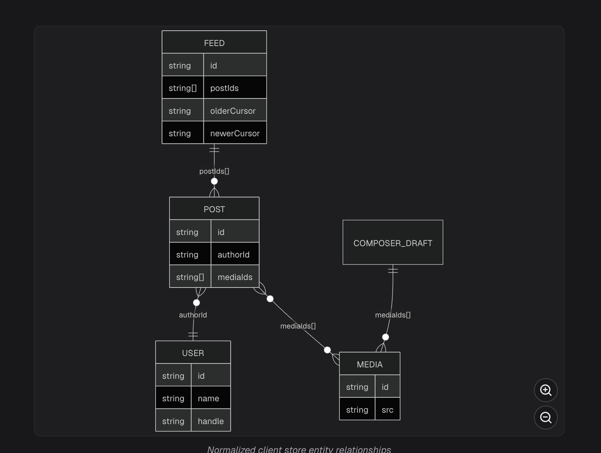
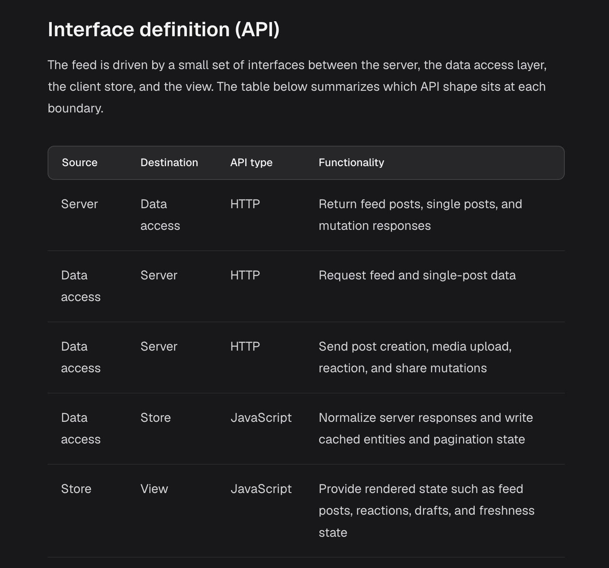

# News Feed System Design — Data Model Summary

The news feed data model follows a normalized client-side store architecture, where entities such as Posts, Users, and Media are stored independently and referenced through IDs.

This makes it easier to manage shared data, pagination, caching, optimistic updates, and consistent UI rendering.

## 1. Overall normalized store

```
type Store = {
  feedsById: Record<string, Feed>;
  postsById: Record<string, Post>;
  usersById: Record<string, User>;
  mediaById: Record<string, Media>;
  composerDraft: ComposerDraft;
};
```

Store

Normalized client-side state

feedsById

Feed ordering + pagination

postsById

Post content + engagement

usersById

User profiles + relationships

mediaById

Images and media metadata

composerDraft

Temporary, unpublished post state

## 2. Feed Entity — Ordering, pagination, and freshness

```
type Feed = {
  id: string;
  generation: string;
  postIds: string[];
  olderCursor: string | null;
  newerCursor: string | null;
  hasOlder: boolean;
  hasNewer: boolean;
  lastFetchedAt: number | null;
};
```

- `id`: Identifies the feed, such as home feed or profile feed.
- `generation`: Identifies a particular feed ranking version or snapshot. Helps avoid mixing pages from different feed orderings when supported by the backend.
- `postIds`: Ordered list of post IDs instead of complete post objects.
- `olderCursor`: Continuation token for fetching older posts as the user scrolls down.
- `newerCursor`: Continuation token or anchor for fetching more recent posts.
- `hasOlder` / `hasNewer`: Indicate whether additional results are available according to the server's pagination contract.
- `lastFetchedAt`: Timestamp used to determine whether the feed should be refreshed.

Key concepts:

- Older posts are appended; newer posts can be prepended.
- Cursor-based pagination is more suitable than offset pagination for frequently changing feeds.
- Generation helps maintain a consistent ranked feed across multiple pagination requests.
- Cursor and `hasMore` flags can be redundant if the API guarantees a null cursor means no additional results.
- A `newerCursor` can remain useful even when `hasNewer` is false, because additional posts may arrive later.

## 3. Post Entity — Content and engagement

```
type Post = {
  id: string;
  authorId: string;
  body: PostBody;
  mediaIds: string[];
  engagementSummary: EngagementSummary;
  viewerReaction: ReactionType | null;
  viewerHasShared: boolean;
  createdAt: string;
};
```

- `id`: Unique identifier of a published post.
- `authorId`: References the author in `usersById`.
- `body`: Contains text and rich-text entities.
- `mediaIds`: References media objects in `mediaById`.
- `engagementSummary`: Aggregated reactions, comments, and shares across users.
- `viewerReaction`: The current authenticated user's reaction.
- `viewerHasShared`: Whether the current viewer shared the post.
- `createdAt`: Post creation timestamp in ISO 8601 format.

### PostBody

```
type PostBody = {
  text: string;
  entities: Array<{
    type: 'mention' | 'hashtag' | 'link';
    start: number;
    end: number;
    userId?: string;
    url?: string;
  }>;
};
```

- Separates plain text from structured metadata for mentions, hashtags, and links.
- `start` and `end` identify substrings using `[start, end)` ranges.
- Offsets use UTF-16 code units against NFC-normalized text.
- Enables clickable mentions, hashtags and links without embedding HTML inside post content.

### EngagementSummary

```
type ReactionType =
  | 'like' | 'love' | 'haha'
  | 'wow' | 'sad' | 'angry';

type EngagementSummary = {
  reactions: Record<ReactionType, number>;
  totalReactions: number;
  commentCount: number;
  shareCount: number;
};
```

- `reactions`: Count for each supported reaction.
- `totalReactions`: Aggregated count of reactions.
- `commentCount` and `shareCount`: Other aggregate engagement metrics.
- `viewerReaction` and `viewerHasShared` are kept separately because they represent what the current viewer did, not the overall engagement.

The viewer's own actions are already included in the aggregate counts.

## 4. User Entity — Shared user information

```
type RelationshipToViewer = {
  isFriend?: boolean;
  isFollowing?: boolean;
  isMuted?: boolean;
  isBlocked?: boolean;
};

type User = {
  id: string;
  name: string;
  handle: string;
  profilePhotoUrl: string;
  isVerified: boolean;
  relationshipToViewer: RelationshipToViewer;
};
```

- Stores profile information independently of posts.
- Multiple posts can reference the same user using `authorId`.
- Updating one normalized user record can update every UI surface subscribed to it.
- `relationshipToViewer` represents personalized information such as following, friendship, mute, or block status.
- Viewer-specific information needs appropriately scoped caching to prevent sharing personalized state across accounts.
- Optional boolean properties may be `undefined`, which should not automatically be interpreted as `false`.

Key concept: Normalization avoids duplicating complete user objects across posts and reduces synchronization complexity.

## 5. Media Entity — Reusable media metadata

```
type Media = {
  id: string;
  src: string;
  previewSrc?: string;
  alt: string;
  width: number;
  height: number;
};
```

- `id`: Unique media identifier.
- `src`: URL of the media resource.
- `previewSrc`: Optional lower-resolution preview URL.
- `alt`: Alternative text for accessibility.
- `width`, `height`: Intrinsic dimensions that can help reserve layout space and prevent layout shifts.

Media records are stored separately and referenced from `Post.mediaIds` or `ComposerDraft.mediaIds`.

## 6. ComposerDraft — Temporary client-side state

```
type ComposerDraft = {
  body: PostBody;
  mediaIds: string[];
  uploadState: 'idle' | 'uploading' | 'failed';
  submitState: 'idle' | 'submitting' | 'submitted' | 'failed';
};
```

- Represents an unpublished post currently being edited.
- `body`: Draft text, mentions, hashtags, and links.
- `mediaIds`: Attached media references.
- `uploadState`: Tracks the media-upload lifecycle.
- `submitState`: Tracks the post-publishing lifecycle.
- Preserves user input when publishing fails so users can retry.

Important distinction: `ComposerDraft` is primarily client-owned UI state, whereas `Post` represents published, server-owned data cached on the client.

After successful publication, the new Post can be added to `postsById` and its ID inserted into the appropriate feed. The draft can then be cleared.

## 7. How the entities connect

Feed: `home-feed`

postIds: [P1, P2, P3]

Post: P1

authorId: U1 · mediaIds: [M1, M2]

User: U1

Author profile

Media: M1, M2

Images and metadata

ComposerDraft

Separate from published posts until submission succeeds

This separates feed ordering from individual entities, allowing the same Post or User to be referenced across multiple screens without copying the entire object.

## 8. Key architectural takeaways for interviews

1. Normalized state: Store entities by ID (`postsById`, `usersById`, `mediaById`) to reduce duplication and simplify updates.
2. Feed ordering: Feed stores ordered `postIds`; Post stores content and engagement independently.
3. Generation consistency: Feed generation can preserve pagination consistency when backend cursors are tied to a ranking snapshot.
4. Cursor pagination: Supports incremental fetching of older and newer posts without relying on shifting offsets.
5. Aggregate vs personalized state: `engagementSummary` describes overall engagement; `viewerReaction` and `relationshipToViewer` describe the current viewer's relationship with an entity.
6. Client vs server state: `composerDraft` holds editable client state; Users, Posts, and Media are generally server-owned entities cached locally.
7. Optimistic updates: Client-side entities can be updated immediately, then reconciled or rolled back after API responses.
8. Caching: Normalization makes updating shared entities easier, but TanStack Query does not automatically normalize results across query keys. This store requires an explicit normalization strategy.
9. Consistency: Entity updates, pagination merges, deduplication, and viewer-specific cache isolation must be handled deliberately.
10. Scalability: Separating entities from feed ordering makes the model easier to extend to profile feeds, search results, post-detail pages, and additional UI surfaces.

Final mental model:

- Feed: Which posts should appear, in what order, and what can be fetched next?
- Post: What is the content, who authored it, and how did users engage with it?
- User: Who is the author, and what is my relationship with them?
- Media: What images or other resources belong to the content?
- ComposerDraft: What is the current user writing or uploading before publishing?
- Store: How do we keep all these entities organized and consistent across the frontend?

This is the core data-model foundation for designing a scalable, client-side news feed.




