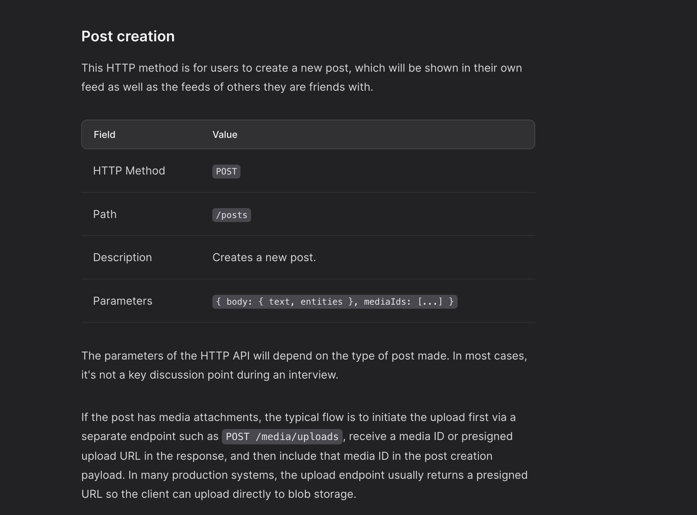
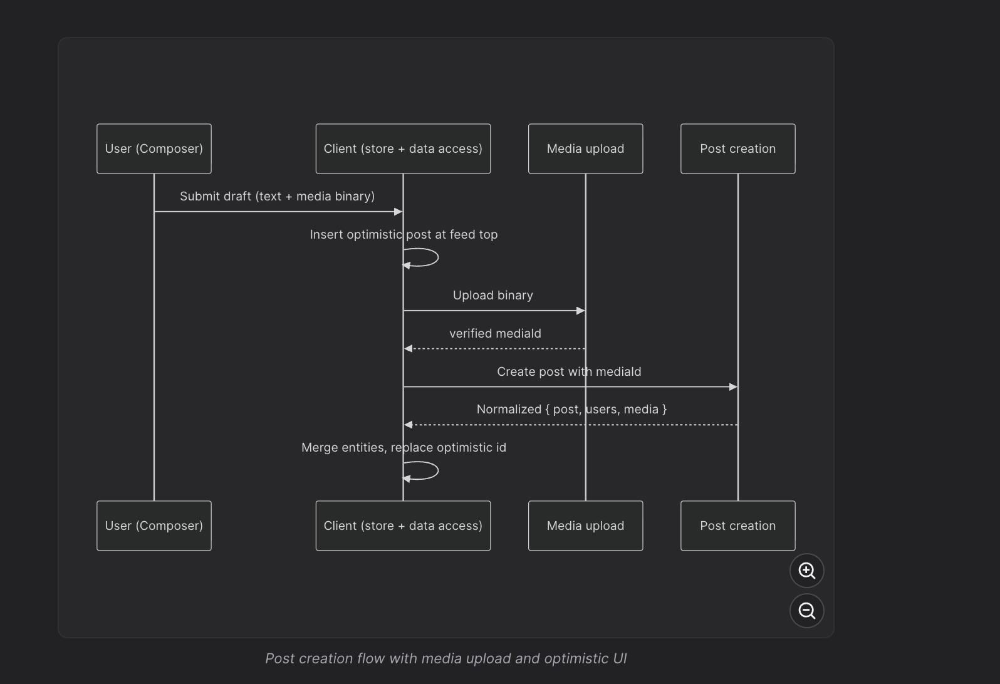

**Upload media binaries first, then create the post by mediaId**

For posts with attachments, upload the binary first, get a mediaId back, then include that ID when creating the post. In production, the upload step often involves getting a presigned URL so the client uploads directly to blob storage, keeping large uploads off the application server and letting post creation stay a small JSON request.

### Response Format

```
{
  "post": {
    "id": "124",
    "authorId": "456",
    "body": { "text": "Hello world", "entities": [] },
    "mediaIds": ["m_1"],
    "engagementSummary": {
      "reactions": {
        "like": 20,
        "love": 0,
        "haha": 15,
        "wow": 0,
        "sad": 0,
        "angry": 0
      },
      "totalReactions": 35,
      "commentCount": 0,
      "shareCount": 0
    },
    "viewerReaction": null,
    "viewerHasShared": false,
    "createdAt": "2021-05-10T09:39:43Z"
  },
  "users": [
    {
      "id": "456",
      "name": "John Doe",
      "handle": "johndoe",
      "profilePhotoUrl": "https://www.example.com/john.jpg",
      "isVerified": false,
      "relationshipToViewer": { "isFriend": true }
    }
  ],
  "media": [
    {
      "id": "m_1",
      "src": "https://www.example.com/feed-images.jpg",
      "alt": "An image alt",
      "width": 1200,
      "height": 800
    }
  ]
}

```

Given this new post data, the client store will need to merge the referenced users and media into their respective collections and prepend the new post ID to the start of the feed's postIds list. In practice, this often works best with optimistic UI: insert a temporary local post immediately, then reconcile it with the canonical server response when the request succeeds.


