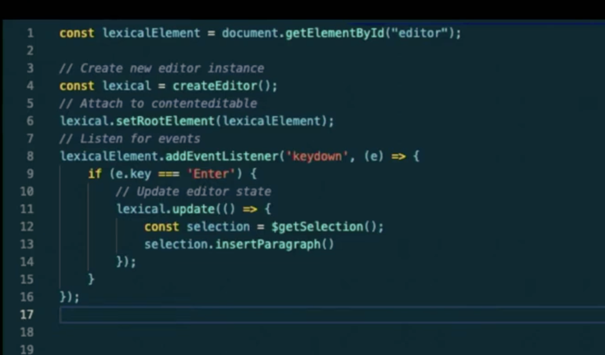
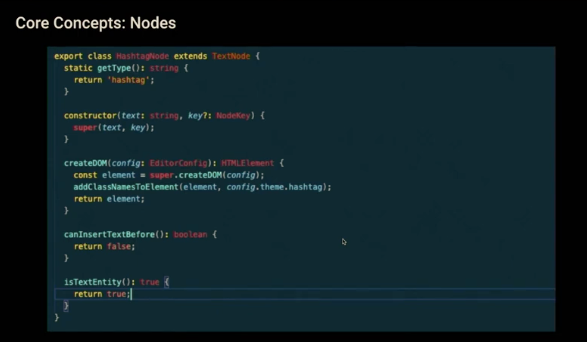
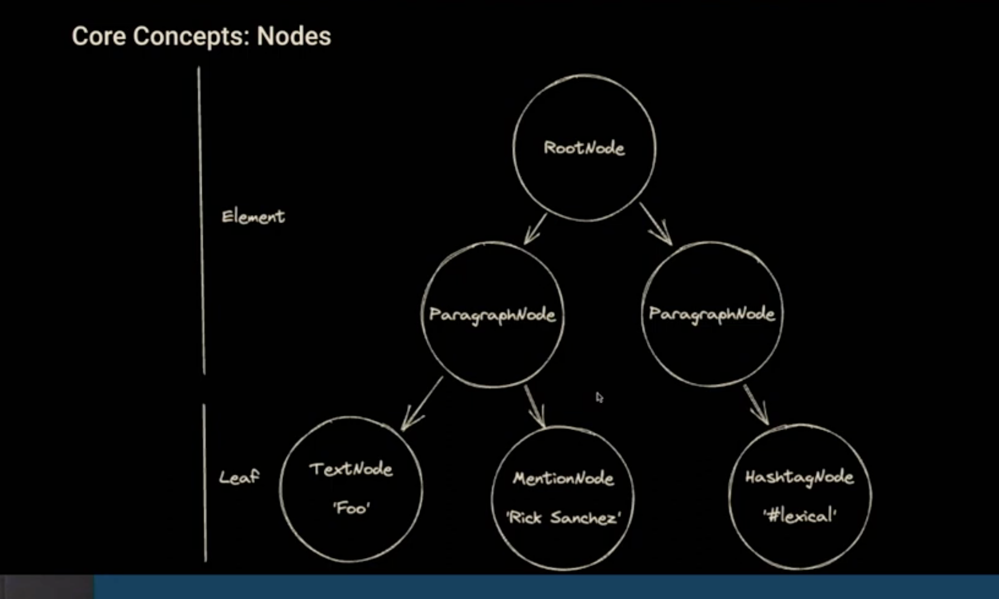
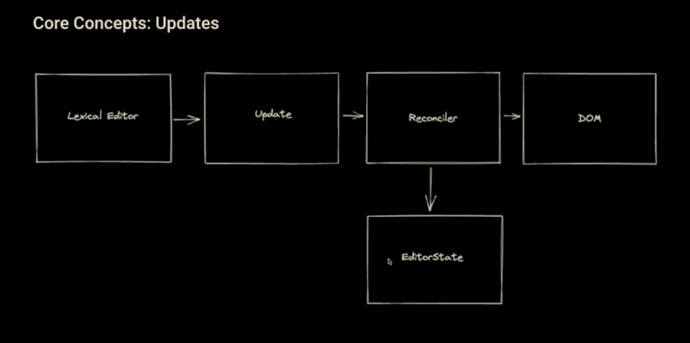
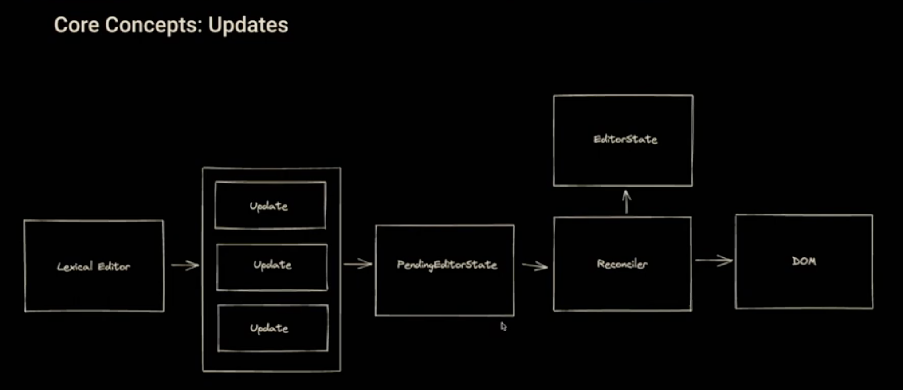
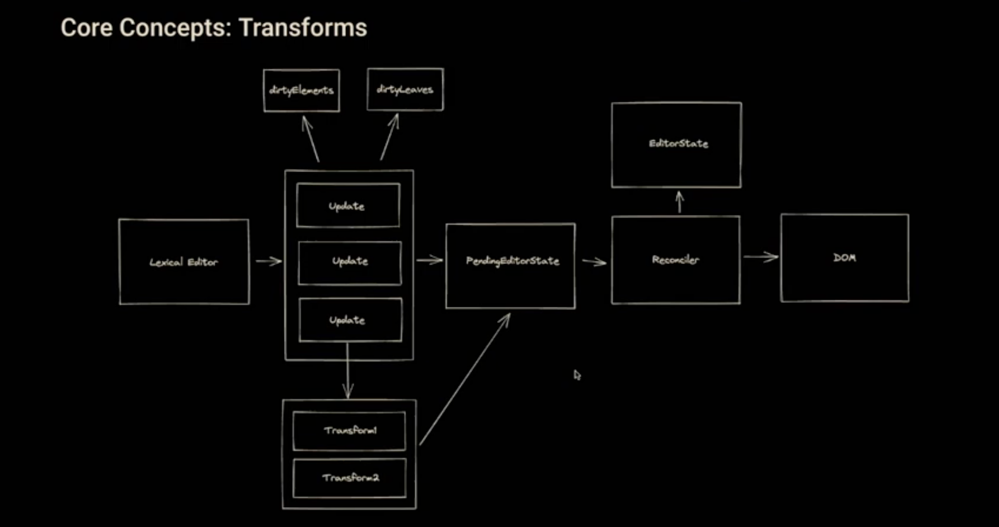
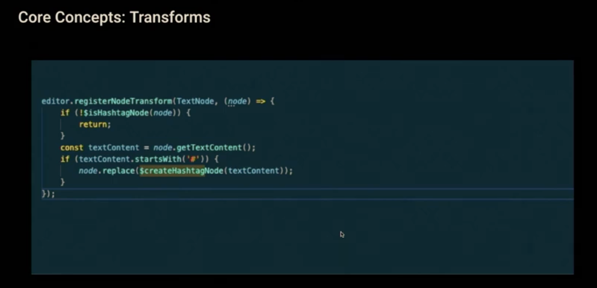
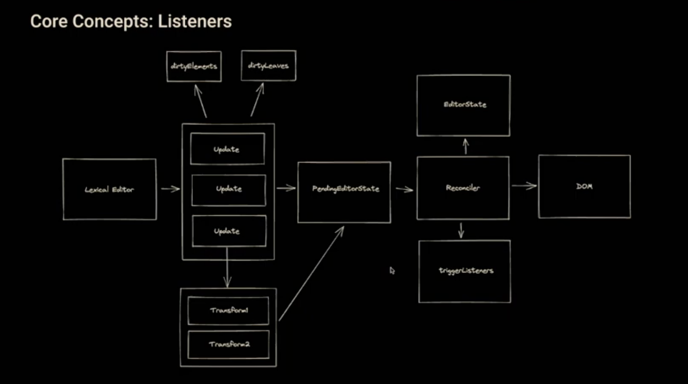

- What is Lexical ?

Lexical is an extensible text editor framework for the web, built for reliability, accessibility, and performance. It gives you a small, dependency-free core and a set of optional packages that you compose into the editor you need, from a plain-text input with mentions to a collaborative rich-text document editor.

Lexical attaches to a contenteditable element and keeps its own model of the document. You read and change that model with Lexical's APIs, and Lexical takes care of keeping the DOM, the selection, and the browser's many contenteditable quirks in sync. Most code never touches the DOM directly; the main exception is custom nodes, which define how they render.

[start with this](https://www.youtube.com/watch?v=EwoS0dIx_OI&t=1659s)

- A library for building Rich Text Editors on the Web
- A core piece of meta infrastructure
- Draft.js -> Superseeded by -> Lexical

* Design Considerations

- Full control over rednering & input handling -> Framework Agnostic. (I think it's written completely in Vanilla javascript)
- Full control over bundle size -> Dependency-free
- Reliability -> Double Buffering/Immutable state
- Extensibility -> Simple, Flexible core APIs + useful abstractions

* How it works

Create Lexical Editor -> Attach to content Editable -> Listen for Events -> Update Editor state -> Profit

- Core Concepts

* Editor state
* Nodes
  
  
* Updates
  
  

* Transforms
  
  
* Listeners
  
* Commands
