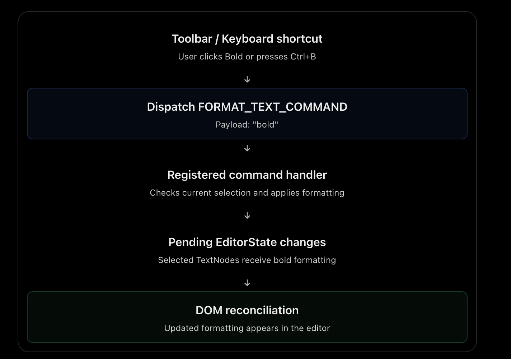

I read the [Lexical — Commands](https://lexical.dev/docs/concepts/commands?utm_source=chatgpt.com) article.

For your senior frontend interviews, Commands are one of the most important Lexical concepts, especially because you've worked on custom nodes and plugins.

You don't need to memorize APIs. Focus on understanding how commands enable communication between the editor, toolbars, plugins, and the document model.

## 1. Important concepts to learn

| Concept                              | Priority   | What you should understand                       |
| ------------------------------------ | ---------- | ------------------------------------------------ |
| Command architecture                 | Must know  | How different editor components communicate      |
| Dispatching and registering commands | Must know  | How an action triggers its handler               |
| Command priorities                   | Must know  | How Lexical decides which handler executes first |
| Event propagation                    | Must know  | How commands are marked as handled               |
| Commands and EditorState updates     | Must know  | How handlers safely modify the document          |
| Custom commands                      | Important  | How plugins introduce new editing operations     |
| Listener cleanup                     | Understand | How to prevent stale listeners and memory leaks  |

## 2. Command architecture — The fundamental model

A Lexical command is a typed message representing an action or event.

For example:

- Apply bold formatting.
- Insert a bullet list.
- Handle Enter or Tab.
- Insert an image.
- Delete a custom node.

The command itself doesn't implement the behavior. A registered handler decides what to do.

This is essentially a command-dispatch pattern that decouples the component triggering an action from the component implementing it.

### Example: User clicks Bold



Updated formatting appears in the editor

This is a simplified flow; Lexical may batch the state commit and DOM reconciliation.

Why is this architecture useful?

A toolbar doesn't need to know how Lexical stores text formatting. It only dispatches a command.

A formatting handler doesn't need to know whether the command originated from a toolbar, keyboard shortcut, or another plugin.

This makes editor features modular and extensible.

## 3. Registering and dispatching commands

There are two primary operations:

- Dispatch: Announce that an action should happen.
- Register: Provide a handler that responds to that action.

For example:

```
// Triggered by a toolbar button
editor.dispatchCommand(FORMAT_TEXT_COMMAND, 'bold');
```

Lexical finds the registered handlers for that command and invokes them according to their priorities.

A handler can inspect the selection, modify nodes, dispatch another command, or decide not to handle the action.

### Commands execute inside update contexts

This is an important connection to your previous reading.

Lexical invokes command handlers within a writable editor update context.

Therefore, handlers can safely inspect the current selection and modify nodes.

If a command is dispatched outside an existing update, Lexical implicitly creates an update.

Interview takeaway: Commands are not separate from Lexical's state management. They're an entry point into its controlled update lifecycle.

## 4. Command priorities and propagation

This is probably the most important interview follow-up from this article.

Multiple plugins can register handlers for the same command.

Consider the Tab key:

- Inside a table, Tab should move to the next cell.
- Inside a list, Tab might indent the list item.
- In a normal editor context, Tab might trigger some default behavior.

How does Lexical decide?

It uses command priorities.

Example: Tab key inside a table

Table plugin handler

Higher priority

Moves selection to the next table cell and returns `true`.

Indentation handler

Lower priority

Not executed because the command has already been handled.

Every handler returns a boolean:

- `true` — The command was handled. Stop propagation.
- `false` — The handler didn't consume the command. Continue to other handlers.

This is conceptually similar to event propagation, but it's Lexical's own command system, not DOM bubbling.

### Important nuance from the current documentation

The current Lexical documentation also introduces `COMMAND_PRIORITY_BEFORE_*` priorities.

These allow custom handlers to execute immediately before built-in behavior without unnecessarily taking over a much higher priority.

For example, a plugin can observe a command, return `false`, and allow the normal editor handler to process it.

You don't need to memorize the entire priority ordering.

Remember: Handlers run in priority order until one returns `true`.

## 5. Custom commands and plugin architecture

Suppose you implemented a custom RFQ reference node in your rich text editor.

A toolbar might expose an action called Insert RFQ Reference.

The flow could look like this:

1. The toolbar dispatches `INSERT_RFQ_REFERENCE_COMMAND`, passing an RFQ ID.
2. Your custom plugin registers a handler for that command.
3. The handler creates a custom node and inserts it at the current selection.
4. Lexical updates EditorState and reconciles the DOM.
5. The custom node renders the RFQ reference.

The toolbar only knows the command and its payload. The plugin owns the insertion logic.

This separation makes it easier to reuse the functionality across keyboard shortcuts, menus and context actions.

## 6. One implementation detail worth remembering

Command handlers need to be unregistered when their owning plugin or extension is disposed.

This prevents duplicate handling and stale registrations.

The documentation also advises against synchronously nesting `editor.update()` or read contexts inside a command handler, because the handler already executes within an update.

## 7. What you can skip

Given your interview timeline, don't spend time memorizing every built-in command constant, exact priority names, the ordering between handlers with identical priorities, or the code for defining extensions.

Understand the architecture and the reasons behind it.

## Final takeaway for your interview

Lexical Commands provide a prioritized, extensible mechanism for translating user actions into editor operations.

Remember these four principles:

1. Decoupling: Toolbars, keyboard events and plugins dispatch commands without knowing their implementations.
2. Extensibility: Plugins can register custom handlers and override or extend built-in behavior.
3. Priorities: When multiple handlers respond to the same command, priority and the `true`/`false` result determine who handles it.
4. State consistency: Command handlers execute within Lexical's update system, ensuring controlled EditorState modifications.

### Likely senior-level interview question

"How would you handle the Tab key differently inside a table versus a normal paragraph?"

A good answer:

> I'd register a command handler for the Tab key in the table plugin. When the selection is inside a table, that handler would move the selection to the next or previous cell and return `true`, preventing other handlers from executing. Outside a table, it would return `false`, allowing the editor's default Tab handling to take over.

This demonstrates that you understand how commands, selection, plugins and priorities work together.

Next: Read [Lexical — Node Transforms](https://lexical.dev/docs/concepts/transforms?utm_source=chatgpt.com).

That will complete the key architectural picture of how Lexical allows plugins to enforce document rules and normalize nodes automatically.
