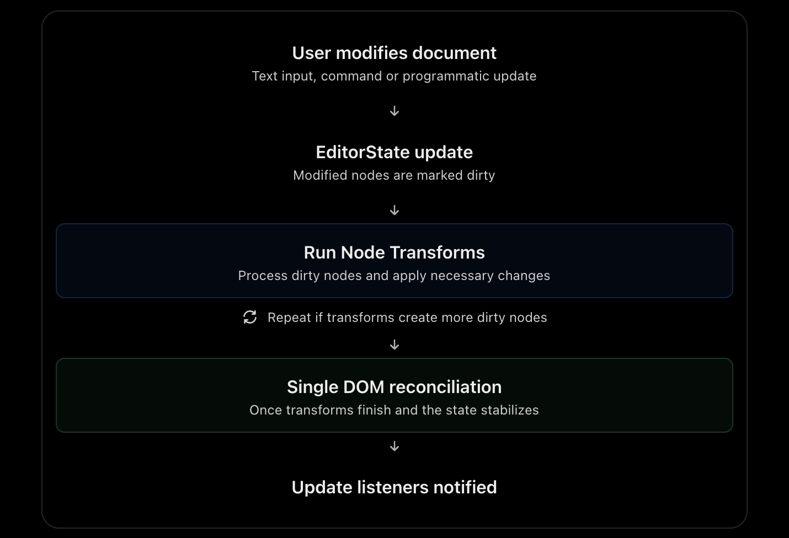

I read the [Lexical — Node Transforms](https://lexical.dev/docs/concepts/transforms?utm_source=chatgpt.com) article.

For your senior frontend interviews, Node Transforms are important because they explain how Lexical automatically maintains document consistency without triggering multiple DOM updates.

You don't need to memorize APIs or Lexical's internal scheduling algorithm. Focus on these five concepts.

## 1. Important concepts to learn

| Concept                          | Priority   | What to understand                                                     |
| -------------------------------- | ---------- | ---------------------------------------------------------------------- |
| Node Transforms                  | Must know  | Automatically modify nodes when relevant changes occur                 |
| Transform lifecycle              | Must know  | Run before DOM reconciliation, within the same update                  |
| Dirty nodes                      | Must know  | How Lexical determines which nodes need processing                     |
| Preconditions and infinite loops | Must know  | Why transforms should only modify nodes when necessary                 |
| Transform heuristic              | Understand | Lexical repeatedly processes dirty nodes until the document stabilizes |
| Text entity transforms           | Understand | How hashtags, mentions and links can be recognized                     |
| RootNode transforms              | Skim       | Run after other transforms as a pre-reconciliation hook                |

## 2. What exactly is a Node Transform?

A Node Transform is a function registered against a particular node type. Lexical executes it when relevant nodes become dirty during an editor update.

For example, imagine your editor automatically converts `#lexical` into a hashtag node.

1. User types `#lexical`.
2. The corresponding `TextNode` changes.
3. Lexical marks that node as dirty.
4. A registered transform checks the text.
5. It recognizes the hashtag and replaces or converts the relevant text into a special node.
6. Lexical reconciles the DOM.

The important part: The conversion occurs within the original update cycle, before DOM reconciliation.

## 3. Transform lifecycle — Most important



Why is this efficient?

Imagine three transforms need to modify a document after the user types.

Rather than committing each change separately, Lexical performs the transformations within the same update cycle and reconciles the DOM once.

This avoids the waterfall updates discussed in the Listeners article.

## 4. Dirty nodes — Important internal concept

Lexical tracks nodes that need processing after changes.

There are two relevant categories:

- Dirty Leaves: Modified leaf nodes such as `TextNode`.
- Dirty Elements: Container nodes such as `ParagraphNode`, which might be dirty because they changed directly or because their descendants changed.

Lexical further distinguishes:

- Intentionally dirty: A node was explicitly marked dirty or obtained for writing.
- Unintentionally dirty: An ancestor element is marked dirty because something inside it changed.

This distinction helps Lexical determine which transforms to execute and which DOM subtrees require reconciliation.

Important nuance: A transform registered for `ParagraphNode` doesn't automatically run whenever the text inside that paragraph changes. An unintentionally dirty ancestor is not the same as an intentionally dirty node.

## 5. Transform heuristic — Understand the idea

Lexical processes dirty nodes in a particular order:

1. Process dirty leaf nodes.
2. Process dirty element nodes.
3. If transforms modify additional nodes, process newly dirty nodes again.
4. Continue until no more transform work remains.

This is called reaching a fixed point — a stable document state where running the transforms again would not produce further changes.

You don't need to memorize the exact algorithm.

The architectural principle is that Lexical normalizes the pending document before committing it to the DOM.

## 6. Preconditions — Preventing infinite loops

This is an important interview follow-up.

Imagine a transform that makes every TextNode bold.

A poor implementation might blindly toggle bold formatting every time it executes:

```
editor.registerNodeTransform(TextNode, (node) => {
  node.toggleFormat("bold");
});
```

This is problematic because changing the node makes it dirty again. The transform may execute repeatedly and keep toggling bold on and off.

A correct transform checks whether a modification is necessary.

```
editor.registerNodeTransform(TextNode, (node) => {
  if (!node.hasFormat("bold")) {
    node.toggleFormat("bold");
  }
});
```

Now the transform performs the change only if the desired condition isn't already satisfied.

This property is called idempotence: applying the same normalization again doesn't change the result.

Interview takeaway: Transforms should have clear preconditions and converge to a stable document state.

## 7. Real-world use cases

| Feature               | How transforms help                                                    |
| --------------------- | ---------------------------------------------------------------------- |
| Hashtags              | Recognize `#topic` and convert matching text into a hashtag node       |
| Auto-link             | Recognize URLs and create link nodes                                   |
| Mentions              | Normalize adjacent mentions or convert matched text into special nodes |
| Custom content blocks | Enforce required node properties or document structure                 |
| Text normalization    | Automatically modify text based on defined editing rules               |

The article also mentions `registerLexicalTextEntity`, a utility for recognizing text patterns and managing special text-based nodes.

You only need to understand its purpose, not its implementation.

## 8. Commands vs Listeners vs Transforms

This is probably the most useful comparison for your interviews.

| Concept        | When it runs                                    | Primary responsibility                            |
| -------------- | ----------------------------------------------- | ------------------------------------------------- |
| Command        | When an action is dispatched                    | Perform an editing operation                      |
| Listener       | When an editor event or update is observed      | React to changes or perform external side effects |
| Node Transform | During an update, when relevant nodes are dirty | Automatically normalize or modify document nodes  |

For example, suppose your editor supports custom product references:

- Command: Insert a product reference when the user selects an item.
- Transform: Ensure adjacent references follow your document's normalization rules.
- Listener: Update an external reference summary when the document changes.

These are complementary mechanisms, not alternatives for every use case.

## Final takeaway for your interview

Node Transforms provide an efficient, declarative way to enforce document rules within Lexical's existing update lifecycle.

Remember four things:

1. Transforms are registered against specific node types.
2. They execute on relevant dirty nodes before DOM reconciliation.
3. They can trigger additional transformations until a stable state is reached.
4. They should use preconditions to prevent unnecessary changes and infinite loops.

### Likely interview question

"Why would you use a Node Transform instead of an UpdateListener to automatically modify content?"

> An UpdateListener runs after a state update has committed. If I modify document content from that listener, it requires another update and potentially another DOM reconciliation.
>
> A Node Transform executes within the existing update cycle, allowing Lexical to normalize the affected nodes before committing the changes. This improves efficiency and avoids waterfall updates. I'd also make my transform idempotent to prevent repeated modifications.

### Where you stand in Lexical preparation

You've now covered the six foundational areas:

- EditorState — How document state is represented.
- Updates — How state modifications are processed.
- Selection — How cursor and text selections work.
- Nodes — How document content is structured.
- Commands — How editing actions are dispatched and handled.
- Listeners and Transforms — How the editor reacts to changes and maintains consistency.

My recommendation: Next, cover [Lexical — History](https://lexical.dev/docs/concepts/history?utm_source=chatgpt.com) briefly, followed by [Lexical — Decorators](https://lexical.dev/docs/concepts/decorators?utm_source=chatgpt.com).

After that, you have enough architectural knowledge to explain a Lexical-based rich text editor in a senior frontend system design interview.
