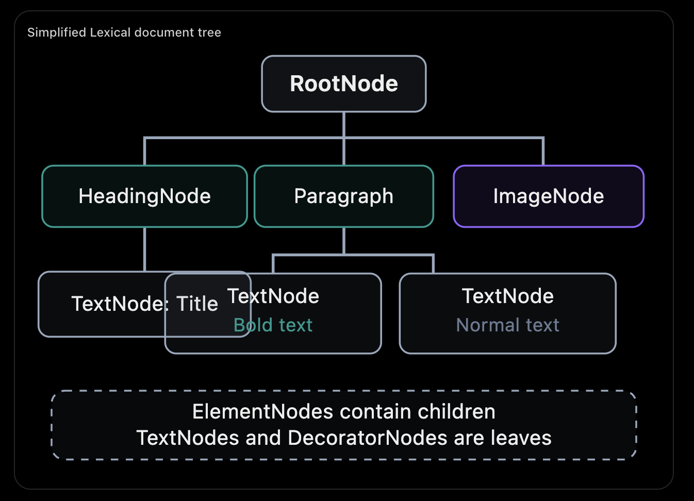
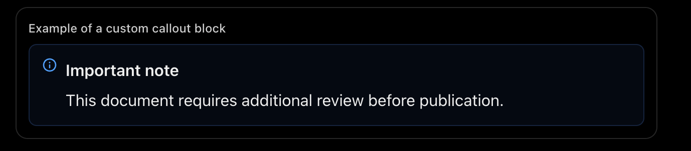

I read the [Lexical — Nodes](https://lexical.dev/docs/concepts/nodes?utm_source=chatgpt.com) article. For your senior frontend interviews, the important thing is to understand how Lexical represents a document using nodes, how different node types behave, and how developers extend the document model.

You can skip most of the implementation examples and API boilerplate.

## 1. Important concepts to learn

| Concept                        | Priority   | What you should understand                            |
| ------------------------------ | ---------- | ----------------------------------------------------- |
| Node-based document model      | Must know  | Documents are represented as a tree of LexicalNodes   |
| Five base node types           | Must know  | Root, Element, Text, LineBreak, Decorator             |
| TextNode formatting and modes  | Must know  | How formatting, token and segmented text work         |
| Custom nodes                   | Must know  | Extending existing node types to support new content  |
| Node identity and immutability | Must know  | Node keys, cloning and copy-on-write                  |
| DOM rendering                  | Important  | How node changes translate into DOM changes           |
| Serialization                  | Important  | How custom node properties are saved and restored     |
| NodeState and `$config`        | Understand | Modern mechanisms for defining custom node properties |

## 2. Lexical's document tree

Lexical doesn't store the document as arbitrary HTML. It represents content as a structured tree of nodes.

For example, imagine a document with a heading, formatted text and an embedded image.

Simplified Lexical document tree



The central principle is that nodes represent document semantics, not merely HTML elements.

For example, a HeadingNode represents a heading regardless of the exact HTML element used to render it.

## 3. The five base node types

Lexical has one common `LexicalNode` base class and five core node types.

| Node            | Purpose                           | Example                                                                                                                         |
| --------------- | --------------------------------- | ------------------------------------------------------------------------------------------------------------------------------- | ------------- |
| `RootNode`      | Top-level document container      | here is only ever a single RootNode in an EditorState and it is always at the top and it represents the contenteditable itself. | Entire editor |
| `ElementNode`   | Contains other nodes              | Paragraph, heading, link                                                                                                        |
| `TextNode`      | Stores actual text and formatting | Bold or italic text                                                                                                             |
| `LineBreakNode` | Represents a line break           | Shift+Enter                                                                                                                     |
| `DecoratorNode` | Embeds custom rendered content    | Image, video, React component                                                                                                   |

Three of these are especially important.

### A. ElementNode — Structural content

- Can contain child nodes.
- Supports block-level structures, such as paragraphs and headings.
- Also supports inline containers, such as links.
- Defines structural behavior, including whether it is inline and whether it can be empty.

Think of ElementNode as a container responsible for document structure.

### B. TextNode — Text and formatting

A TextNode is a leaf node that contains text.

It supports formatting properties such as bold, italic, underline and strikethrough.

An important detail: TextNodes support different editing modes.

| Mode      | Behavior                                | Example                       |
| --------- | --------------------------------------- | ----------------------------- |
| Normal    | Characters can be edited individually   | Ordinary paragraph            |
| Token     | Treated as an indivisible piece of text | A mention like `@alex`        |
| Segmented | Can be deleted in segments              | A word-based text interaction |

The distinction matters when building mentions, tags and other specialized text experiences.

### C. DecoratorNode — Custom UI components

This is particularly relevant to your Lexical experience.

A `DecoratorNode` lets you embed arbitrary rendered content inside the editor.

Examples include image previews, video players, interactive charts and custom React components.

A DecoratorNode is a leaf in the Lexical document tree. Its rendered UI may be complex, but that UI is not represented as editable Lexical child nodes.

Interview takeaway: If I need a new container that holds editable document content, I generally extend `ElementNode`. If I need an embedded UI component, I consider `DecoratorNode`.

## 4. Custom nodes — How extensibility works

Suppose you're building a document editor that supports special callout boxes.



You could create a custom `CalloutNode` by extending `ElementNode`.

That custom node can define:

- Structure: What child nodes it accepts.
- Behavior: Whether users can insert or delete text around it.
- Rendering: How it appears in the DOM.
- Properties: Its type, label, severity or other metadata.
- Serialization: How to preserve it when saving and loading the document.

This is why Lexical's node model is powerful: developers can extend document semantics without managing arbitrary HTML directly.

## 5. Node identity, cloning and immutability

This connects directly to the EditorState and Updates articles you've already covered.

Every Lexical node has an internal identity called a NodeKey.

When an editor update modifies a node, Lexical uses copy-on-write behavior:

1. The current EditorState contains an immutable version of the node.
2. The pending EditorState initially shares unchanged nodes.
3. When a node must change, Lexical obtains a writable version, cloning it when necessary.
4. The modified node becomes part of the pending state.
5. Once committed, the new state becomes immutable.

This allows unchanged nodes to be shared across snapshots rather than copying the entire document on every keystroke.

The important distinction is that NodeKey identifies a node within the editor, while cloning allows different EditorState snapshots to contain different versions of that logical node.

NodeKeys are internal identities; they should not be treated as persistent database IDs.

## 6. DOM rendering and serialization

Every custom node needs to participate correctly in two separate processes.

DOM rendering

Lexical must know how to create the corresponding DOM and update it when the node changes.

For example, when a callout changes from informational to warning, Lexical can update its styling without unnecessarily replacing the entire DOM element.

Serialization

Lexical must also preserve custom node data when exporting and importing documents.

For example:

```
{
  "type": "callout",
  "label": "Important note",
  "tone": "warning",
  "children": []
}
```

This is a simplified conceptual representation, not an exact serialized Lexical node.

The key idea is that rendering and persistence are separate concerns.

A node's stored data describes what it represents. Its rendering logic determines how that data appears.

The current documentation also describes `$config`, declarative serialization schemas and `NodeState`. You should understand their purpose rather than memorize their syntax:

- `$config` describes a node's type, inheritance and configuration.
- Serialization schemas define valid custom properties and support cloning and JSON conversion.
- `NodeState` attaches additional state to nodes, including existing node types, without necessarily creating subclasses.

The new declarative serialization schema introduced in Lexical v0.51.0 is marked experimental in the documentation.

## 7. What can you skip?

Given your time constraints, I would skim the lengthy code examples for custom node subclasses, legacy `getType()` and `clone()` implementations, TypeScript nominal typing, abstract class configuration, and the details of serialization schema combinators.

Those are implementation details you can revisit when you actually build a custom node.

## Final takeaway for your interview

Lexical uses a structured, extensible node tree as its document model. Nodes represent content and behavior independently of the DOM.

The five ideas worth retaining are:

1. Document structure: `ElementNode` represents containers; `TextNode` represents text; `DecoratorNode` embeds custom UI.
2. Formatting: Text formatting is stored as properties on text nodes rather than requiring arbitrary nested HTML.
3. Extensibility: Custom nodes allow developers to introduce application-specific document elements and behavior.
4. Immutability: Node identity and copy-on-write cloning make EditorState updates efficient and predictable.
5. Rendering and persistence: A node defines how it renders and how its data survives serialization.

### A likely interview follow-up

"How would you implement a custom image or callout node in Lexical?"

Your answer should explain which base node you'd extend, what data it stores, how it renders, how users select or edit it, and how the node is serialized.

For your preparation, I would now move to Commands, followed by Node Transforms. Together with EditorState, Updates, Selection and Nodes, these explain most of Lexical's fundamental editing architecture.

Source: Lexical Nodes documentation, read from your open browser tab.
