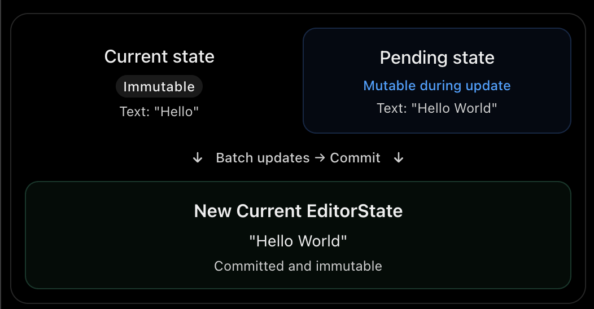

I've reviewed the [Lexical — Updates](https://lexical.dev/docs/concepts/updates?utm_source=chatgpt.com) documentation.

For your senior frontend interviews, I recommend focusing on 4 core concepts. The remaining details are useful but lower priority.

## 1. Important concepts to learn

| Concept                   | Priority | What you should understand                                                           |
| ------------------------- | -------- | ------------------------------------------------------------------------------------ |
| 1. Update lifecycle       | High     | How Lexical processes changes from user input to DOM updates                         |
| 2. Double buffering       | High     | Why Lexical maintains current and pending EditorStates                               |
| 3. DOM reconciliation     | High     | How Lexical efficiently updates only changed DOM nodes                               |
| 4. External DOM mutations | High     | How Lexical handles browser-generated changes without losing control of its document |
| 5. Update tags            | Medium   | How Lexical identifies special operations like undo/redo, paste and collaboration    |
| 6. Discrete updates       | Low      | How to force synchronous commits when necessary                                      |

## 2. The four concepts explained

### 1. Update lifecycle

Every document modification happens inside an update.

```
editor.update(() => {
  const root = $getRoot();
  root.append($createParagraphNode());
});
```

- The callback runs synchronously.
- Changes are applied to a pending EditorState.
- Node transforms run.
- Lexical schedules a commit.
- The DOM is reconciled.
- Update listeners are notified.

Important distinction: The update callback executes synchronously, but the DOM reconciliation and state commit are normally batched.

### 2. Double buffering

This is probably the most important concept in the article.

Lexical maintains two versions of its EditorState:

- Current EditorState: Immutable, committed state.
- Pending EditorState: Working copy where changes are applied.



Why use double buffering?

- Multiple updates can be batched together.
- The current state remains stable while changes are being prepared.
- Only the pending state is modified.
- Previous immutable snapshots provide a foundation for undo/redo.

Think of this as conceptually similar to React's rendering model, although Lexical's internals are different.

### 3. DOM reconciliation

Suppose your document contains 100 paragraphs, and the user modifies only one.

Lexical doesn't need to recreate all 100 paragraphs.

- It tracks which editor nodes changed.
- The reconciler updates the corresponding DOM.
- Unchanged nodes can be left alone.
- This reduces unnecessary DOM manipulation.

Interview takeaway: Lexical uses its structured document model to reconcile changed nodes efficiently, rather than doing a generic virtual DOM diff of the entire document.

### 4. Handling external DOM mutations

This connects directly to your earlier question about why `contentEditable` is insufficient.

Lexical considers the EditorState its source of truth, but the browser may modify the DOM independently.

Lexical uses input events and a `MutationObserver` to handle these changes.

| DOM change                                    | Lexical behavior                                               |
| --------------------------------------------- | -------------------------------------------------------------- |
| User types ordinary text                      | Accepts the native input and synchronizes its TextNode         |
| Browser spellcheck corrects text              | Reads supported text changes into EditorState                  |
| IME composition modifies text                 | Handles native composition while preserving editor consistency |
| External script inserts an unexpected element | Reverts unsupported structural modifications                   |
| Browser extension removes a managed DOM node  | Restores the DOM to match EditorState                          |

An important nuance: Lexical doesn't blindly reject all DOM mutations. It preserves legitimate native text input while rejecting unexpected structural changes.&#x20;

[image](https://www.google.com/s2/favicons?domain=https://lexical.dev&sz=32)

Lexical

## 3. Update tags — Understand, don't memorize

Tags attach metadata to an update so other parts of the editor can understand its purpose.

Some important tags:

| Tag                      | Purpose                                              |
| ------------------------ | ---------------------------------------------------- |
| `HISTORY_PUSH_TAG`       | Force a new undo-history entry                       |
| `HISTORY_MERGE_TAG`      | Merge with the previous history entry                |
| `PASTE_TAG`              | Identify a paste operation                           |
| `COLLABORATION_TAG`      | Identify collaborative editing changes               |
| `SKIP_COLLAB_TAG`        | Exclude an update from collaboration synchronization |
| `SKIP_DOM_SELECTION_TAG` | Avoid changing the DOM selection                     |

Example:

```
editor.update(
  () => {
    // Modify document
  },
  { tag: HISTORY_PUSH_TAG }
);
```

You can inspect these tags inside an update listener.

This becomes particularly useful when implementing history, plugins and collaborative editing.

## 4. Final takeaway for your interviews

The main idea of this article is:

Lexical separates document modifications from DOM updates using a controlled, batched update lifecycle.

Here's the flow you should remember:

User input / editor command

editor.update() — pending EditorState modified

Node transforms run

Batch commit + DOM reconciliation

New immutable EditorState + listeners notified

### Three senior-level interview questions you should be able to answer

1. Why does Lexical use double buffering? To separate the immutable committed state from ongoing changes, batch updates and maintain predictable snapshots.
2. How does Lexical avoid unnecessary DOM updates? Through reconciliation based on which nodes changed rather than rebuilding the entire document.
3. What happens if the browser directly modifies the contentEditable DOM? Lexical accepts supported native text changes, but reverts unsupported structural changes to maintain consistency with EditorState.

My recommendation: You've now covered EditorState and Updates. Move to Nodes, Selection, and Commands next. Those will be especially relevant when explaining custom nodes and plugins you've implemented at Parspec.
